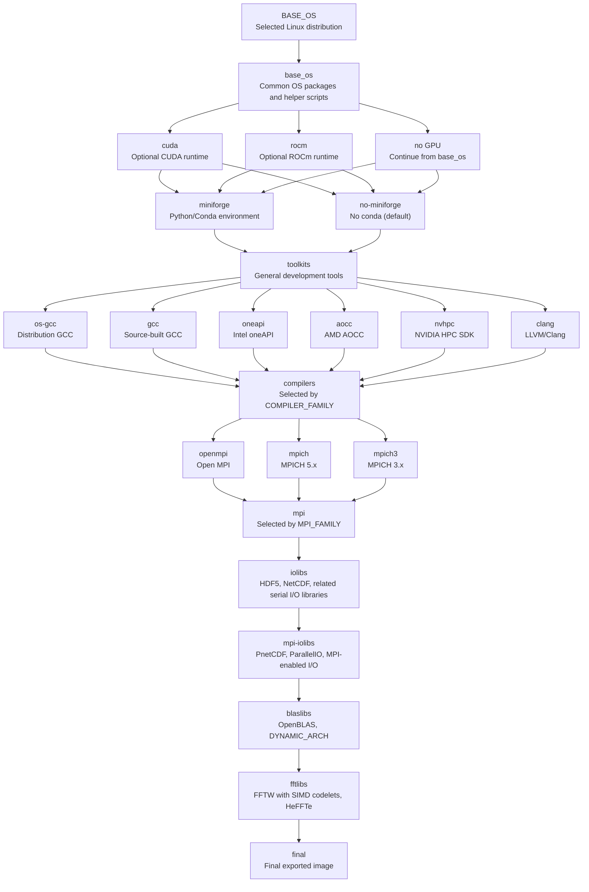

# HPC CI/CD Container Infrastructure

> **Source and licence.** This is a copy of the container factory from
> [kedziora-csg/demo_github_actions](https://github.com/kedziora-csg/demo_github_actions),
> itself a fork of [benkirk/demo_github_actions](https://github.com/benkirk/demo_github_actions)
> by Benjamin S. Kirk, who wrote the factory. It is distributed, as the original
> is, under the Creative Commons Attribution-ShareAlike 4.0 International licence
> ([LICENSE.md](LICENSE.md)). The history is kept, so the commits after the copy
> show what has changed. The benchmark runner that runs these images on NCAR's
> clusters stayed behind in kedziora-csg/demo_github_actions.

## Overview

This repository defines a continuous integration and continuous delivery (CI/CD) system for building, validating, and publishing containerized high-performance computing (HPC) development environments. The principal deliverables are multi-layer Docker images that combine operating systems, compiler toolchains, MPI implementations, optional GPU runtimes, and commonly used scientific libraries.

The images are intended to provide reproducible development and testing environments for HPC software stacks. They are published to the GitHub Container Registry as `ghcr.io/ncar/hpcdev-<arch>`, are public, and can be pulled without credentials.

The core implementation is the container build system under `containers/devenv` and the GitHub Actions workflows that generate and execute the build matrix.

The design relies on a parameterized multi-stage Dockerfile, centralized environment configuration, source-built scientific libraries, and GitHub Actions workflows that expand and validate many compiler, MPI, GPU, architecture, and operating-system combinations. The published images are **portable**: built with no `-march`, so they run on any CPU of their architecture, while the libraries that matter most for speed (OpenBLAS, FFTW) choose their kernels for the CPU at run time. What every image promises to software built on it is stated in [CONTRACT.md](CONTRACT.md).

Three workflows build images: `cluster-images-ghcr.yaml` builds the six images NCAR's clusters use, `matrix-build-images-ghcr.yaml` builds the full matrix for one operating system, and `dial-an-image-ghcr.yaml` builds one hand-picked variant, for example a stand-in for a particular system. Published images and their tags are listed on the [hpcdev-x86_64 package page](https://github.com/orgs/NCAR/packages/container/package/hpcdev-x86_64).

## Using an Image

```bash
docker run -it --rm ghcr.io/ncar/hpcdev-x86_64:leap-gcc14-openmpi-latest
```

opens a login shell with the whole stack on `PATH` (on an Apple Silicon Mac, add `--platform linux/amd64`). To run one command, give it as plain words, for example `docker run --rm <image> mpicc --version`; the entrypoint is already a login shell, and wrapping the command in `bash -lc '...'` runs only its first word. To check that an image keeps its contract, run `/container/extras/check_base_contract.sh --published` inside it. On a cluster, Apptainer builds a `.sif` from the same reference:

```bash
apptainer pull hpcdev.sif docker://ghcr.io/ncar/hpcdev-x86_64:leap-gcc14-openmpi-latest
apptainer exec hpcdev.sif /container/extras/check_base_contract.sh --published
```

Tags have the form `<os>-<compiler>-<mpi>[-<gpu>][-conda]-latest`, plus a copy dated `-YY.MM`; [CONTRACT.md](CONTRACT.md) explains each part. Pin an image by digest for reproducibility.

## Image Composition

Each development image represents a selected combination of several major dimensions:

- Linux distribution
- Compiler family and compiler version
- MPI implementation
- Optional GPU runtime
- Processor architecture
- Scientific library versions

The scientific software stack is built primarily from source. The common library set includes HDF5, NetCDF C, NetCDF Fortran, PnetCDF, ParallelIO, OpenBLAS, FFTW, and HeFFTe. Conda (Miniforge) is optional and off by default. These libraries are layered on top of the selected compiler and MPI stack so that the final image can be used to build, test, and package HPC applications.

## Repository Layout

The repository is organized around container definitions, build scripts, deployment configuration, and workflow automation.

### Core Development Container

The central file in the repository is:

```text
containers/devenv/Dockerfile
```

This Dockerfile contains the primary build logic. It is a large, multi-stage Dockerfile with more than twenty named stages. Most substantive changes to the container stack occur in this file, including changes to base images, compiler installation, MPI builds, library versions, environment setup, and final image assembly.

For a more detailed description of the Dockerfile, see [DockerfileDoc.md](DockerfileDoc.md) and some contextual aspects below.

The related file:

```text
containers/devenv/Makefile
```

prepares the Docker build context by copying the contents of `scripts/` into the build context as `extras/`, which every image carries as `/container/extras/`. These scripts provide examples of build instructions for HPC simulation software or benchmarking software that rely on the provided development tool chains, and the tools the contract promises.

### Supporting Containers

Several smaller container definitions are located beneath `containers/`. Each is built from a caller-supplied `BASE_IMAGE`, so these images are secondary consumers of the main development image rather than independent base images:

- `containers/test/` builds test-runner images on top of a development image, including support for smoke tests and benchmark execution.
- `containers/publish/` builds the production image on top of the CI-built development image and can run deployment scripts before publication.

The publish step in the GitHub Actions (GHA) workflow attaches Software Bill of Materials metadata by setting `sbom: true` on the Docker build action, enabling downstream vulnerability, license, and supply-chain analysis. The `containers/publish/Dockerfile` itself only defines the final image build steps.

### The Base Contract

[CONTRACT.md](CONTRACT.md) states what every image promises to anything built on it: the tag format, `/container/config_env.sh` and the entrypoint, `build_common.cfg`, `MARCH_FLAGS`, the compiler and MPI wrappers, the diagnostic tools, and the libraries. `scripts/check_base_contract.sh` checks each promise from inside an image, and CI runs it on every build and on every published image. A change to a promise is a change to both files.

The benchmark runner that deploys these images on NCAR's clusters -- `hpcrun/`, `sites/`, `sif/` and the app images in `apps/` -- lives in [kedziora-csg/demo_github_actions](https://github.com/kedziora-csg/demo_github_actions) and depends on this repository only through the contract.

### Build and Application Scripts

The `scripts/` directory contains build helpers for larger HPC applications and software frameworks, including examples such as WRF, CESM, ESMF, PETSc, DART, MPAS, and Kokkos; they test that the stack can build real science codes. It also contains sample programs such as `hello_world.*`, the build scripts for `report_placement` and the OSU Micro-Benchmarks (with OSU's app contract in `app.d/osu/`), `report_cpu_features.sh`, and `check_base_contract.sh`. Only files whose names contain a dot are copied into the image.

The shared file:

```text
scripts/build_common.cfg
```

is sourced by build scripts and defines common variables such as `INSTALL_ROOT` and `STAGE_DIR`.

### GitHub Actions Configuration

The `.github/workflows/` directory contains the automation that drives image construction, testing, and publication. Important workflows include:

- `build-hpc-dev-image-ghcr.yaml`, the reusable build, test and publish workflow
- `cluster-images-ghcr.yaml`
- `matrix-build-images-ghcr.yaml`
- `dial-an-image-ghcr.yaml`

These will be discussed below.

The `.github/actions/` directory also contains composite actions used by the workflows. In particular, `slim-action-runner` and `docker-cleanup` help manage limited disk space on GitHub-hosted runners.

## Dockerfile Architecture

The primary development image is built from a parameterized multi-stage Dockerfile. The Dockerfile is organized as a directed acyclic graph of build stages, where Docker build arguments select which concrete stage should provide each logical layer.

For a focused summary of the Dockerfile structure, see [DockerfileDoc.md](DockerfileDoc.md).

At a high level, the build graph follows this structure:

```text
base_os -> optional GPU runtime -> miniforge | no-miniforge -> toolkits ->
compiler -> MPI -> I/O libraries -> MPI I/O libraries ->
OpenBLAS -> FFT libraries -> final image
```

The major logical layers are:

1. Base operating system
2. Optional CUDA or ROCm runtime
3. Optional Miniforge Python environment (off by default)
4. General development toolkits
5. Compiler toolchain
6. MPI implementation
7. Serial scientific I/O libraries
8. MPI-enabled I/O libraries
9. OpenBLAS (`blaslibs`)
10. FFT libraries (`fftlibs`)
11. Final image assembly

This design allows a single Dockerfile to produce many variants without duplicating large sections of build logic.


## Build Argument Selection

Docker build arguments determine how the multi-stage graph is assembled. Representative selector arguments include:

- `BASE_OS`
- `COMPILER_FAMILY`
- `MPI_FAMILY`
- `MINIFORGE_PREREQ`
- `TOOLKITS_PREREQ`
- `IOLIBS_PREREQ`
- `BLASLIBS_PREREQ`
- `FFTLIBS_PREREQ`
- `FINAL_TARGET`

The `BASE_OS` argument selects the Linux distribution or vendor-provided base image. Representative values include AlmaLinux, Rocky Linux, openSUSE Leap, openSUSE Tumbleweed, Ubuntu Jammy, and Ubuntu Noble variants, with additional CUDA or ROCm variants where applicable.

## Dependency Flow Chart



## Base OS Comparison Summary

Choosing the right base image for your CI/CD pipelines dictates your build speed, security posture, and how closely your testing environment mirrors production. The six distributions used here fall into three distinct families, each optimizing for a different point on the stability-versus-freshness spectrum.

## The Enterprise Linux Derivatives

When your production environment runs Red Hat Enterprise Linux (RHEL), using a RHEL-compatible distribution for your containers ensures your CI/CD pipeline tests exactly what will be deployed.

### AlmaLinux

AlmaLinux is a community-owned enterprise operating system governed by a non-profit foundation. Following Red Hat's source code availability changes in 2023, AlmaLinux shifted its focus to maintaining **Application Binary Interface (ABI) compatibility** with RHEL, pulling sources from CentOS Stream and RHEL to ensure software runs identically.

* **Advantages:** Extreme stability and a 10-year support lifecycle. It is highly reliable for mirroring enterprise production environments without incurring licensing costs.
* **Disadvantages:** It prioritizes stability over freshness. You will not have access to the latest compilers or language runtimes out of the box without enabling modular or third-party repositories. Base images also tend to be larger than minimal Alpine or Debian images.

### Rocky Linux

Rocky Linux is another free enterprise operating system, founded by the original creator of CentOS. Unlike AlmaLinux, Rocky Linux continues to target **1:1 bug-for-bug compatibility** with RHEL.

* **Advantages:** It shares the exact same technical benefits as AlmaLinux — enterprise-grade stability, long lifecycles, and a behavior profile identical to RHEL.
* **Disadvantages:** The technical drawbacks are identical to AlmaLinux (older toolchains, larger footprint). The primary difference is organizational: Rocky Linux is backed by a B-Corp (the Rocky Enterprise Software Foundation) rather than a non-profit foundation.

## The SUSE Ecosystem

The openSUSE family is deeply integrated into European enterprise environments and offers robust package management through Zypper.

### openSUSE Leap

Leap is a regular point-release distribution built from the exact same binary packages as SUSE Linux Enterprise (SLE).

* **Advantages:** Excellent predictability and enterprise-grade stability. It strikes a balance between stability and updated software, making it highly reliable for pipelines deploying to SUSE-heavy infrastructure.
* **Disadvantages:** The openSUSE container ecosystem is smaller than those of RHEL and Ubuntu. You may find fewer pre-built third-party Docker layers and community troubleshooting guides.

### openSUSE Tumbleweed

Tumbleweed is a rolling-release distribution, meaning it continuously updates packages to the latest stable versions rather than relying on massive point-release upgrades.

* **Advantages:** It provides immediate access to the absolute newest kernels, compilers, and language versions. It is highly valuable in CI/CD when you need to test your application against upcoming software updates to catch breaking changes early.
* **Disadvantages:** A rolling release is a double-edged sword in automation. If you do not strictly pin your dependencies, an upstream package update can unexpectedly break a previously functioning CI/CD pipeline.

## The Ubuntu LTS Series

Ubuntu Long Term Support (LTS) releases are the default standard for many cloud-native applications due to their massive community and broad compatibility.

### Ubuntu Jammy (22.04 LTS)

Released in 2022, Jammy Jellyfish is an established, widely adopted LTS release.

* **Advantages:** Universal compatibility. Almost every third-party vendor builds and tests for Ubuntu 22.04 first. The ecosystem is massive, making troubleshooting and finding optimized base layers effortless.
* **Disadvantages:** Because the core packages are locked to their 2022 versions, developers relying on newer language features (like recent Python or GCC updates) often have to build them from source or pull from external repositories.

### Ubuntu Noble (24.04 LTS)

Released in 2024, Noble Numbat is Canonical's current LTS standard.

* **Advantages:** It updates the entire software stack to modern standards, providing newer default toolchains, security features, and language runtimes out of the box, while still guaranteeing 5 years of standard support.
* **Disadvantages:** Being newer, some legacy proprietary software or older CI/CD build scripts may still expect the Jammy environment and might require slight modifications to run smoothly.

---

## Base Image Comparison Summary

| Distribution | Release Model | CI/CD Sweet Spot |
| --- | --- | --- |
| **AlmaLinux** | Point Release (10-yr LTS) | Mirroring RHEL production environments. |
| **Rocky Linux** | Point Release (10-yr LTS) | Mirroring RHEL production environments. |
| **openSUSE Leap** | Point Release (Aligned with SLE) | Stable pipelines targeting SUSE infrastructure. |
| **openSUSE Tumbleweed** | Rolling Release | Testing applications against bleeding-edge dependencies. |
| **Ubuntu Jammy** | Point Release (2022 LTS) | Maximizing compatibility with legacy tools and scripts. |
| **Ubuntu Noble** | Point Release (2024 LTS) | Modern cloud-native development with long-term stability. |


The `COMPILER_FAMILY` argument selects the compiler layer. Supported compiler families include distribution GCC, GCC built from source, Intel oneAPI, AOCC, NVHPC, and Clang.

The `MPI_FAMILY` argument selects the MPI implementation, typically OpenMPI, MPICH 5.x, or MPICH 3.4.x.

The `*_PREREQ` arguments are especially important because they connect the logical stages in the Docker build graph. For example, setting `MINIFORGE_PREREQ=cuda` places the Miniforge layer on top of the CUDA-enabled stage, and `TOOLKITS_PREREQ=no-miniforge` leaves conda out, which the build workflow does unless its `conda` input is on. Similarly, setting `IOLIBS_PREREQ=mpi` enables parallel HDF5 and NetCDF builds by placing the I/O library stage after the MPI stage.

## Environment Configuration

The in-container environment is accumulated through the file:

```text
/container/config_env.sh
```

Individual Docker stages append `export` statements to this file through the `add_conf` helper. The file contains paths, compiler settings, and library search configuration, including values such as:

- `PATH`
- `CPATH`
- `LIBRARY_PATH`
- `LD_LIBRARY_PATH`
- `CC`
- `CXX`
- `FC`
- `CFLAGS`

This configuration file is sourced by login shells inside the container and serves as the authoritative description of the runtime environment. Because the image is assembled from many independently built layers, a centralized environment file helps ensure that later stages can locate compilers, headers, libraries, and tools installed by earlier stages.

Libraries are installed under versioned prefixes beneath `/container/`, which makes the image layout explicit and easier to inspect, much as `/opt/` holds optional software on a host. For example, in `hpcdev-x86_64:leap-gcc14-openmpi-26.10`:

```
# ls /container
app.d  c-blosc        extras  gcc   heffte  netcdf    openmpi               parallelio  szip
bin    config_env.sh  fftw    hdf5  logs    openblas  osu-micro-benchmarks  pnetcdf
```

`/container/extras/` holds the scripts copied from `scripts/`, which show how applications can be built on this tool chain:

```
# ls /container/extras
Dockerfile                     build_muram.sh                 hello_world_mpi.cxx
app.d                          build_osu-micro-benchmarks.sh  install_conda.sh
build_cesm.sh                  build_petsc.sh                 install_npl.sh
build_common.cfg               build_report-placement.sh      parallel_stl_sort.cxx
build_cuda_samples.sh          build_wrf.sh                   remove_static_bloat.sh
build_dart.sh                  check_base_contract.sh         report_cpu_features.sh
build_esmf.sh                  hello_world.c                  report_placement.cxx
build_fasteddy.sh              hello_world.cu                 update_headers.pl
build_kokkos.sh                hello_world.cxx
build_mpas.sh                  hello_world.f90
```

## NVHPC-Specific Handling

NVHPC is installed from the `cuda_multi` tarball. Because GitHub Actions runners have limited disk capacity, unused CUDA versions bundled inside the NVHPC SDK are excluded during extraction and removed again after installation.

When the separately installed CUDA version matches the CUDA version bundled with NVHPC, the build avoids duplicating the CUDA installation by using a symlink.

When updating NVHPC, maintainers must update both the `NVHPC_URL` and the CUDA version-specific exclusion and removal paths. These paths must correspond to the CUDA version bundled by the new NVHPC SDK.

## Version Management

Default software versions are declared as Dockerfile `ARG` values. However, the authoritative versions used in CI are defined by the GitHub Actions matrices, which override the Dockerfile defaults through build arguments.

The most important workflow files for version management are:

```text
.github/workflows/matrix-build-images-ghcr.yaml    the full matrix; authoritative
.github/workflows/cluster-images-ghcr.yaml         the clusters' six images; mirrors it
```

A typical version bump requires editing one or more of the following matrix entries:

- `compiler_build_args`
- `mpi_build_args`
- `extra_build_args`

Library versions such as HDF5, NetCDF, ParallelIO, and related dependencies are generally controlled through `extra_build_args`.

For NVHPC updates, the Dockerfile must also be reviewed for CUDA exclusion and removal paths, because these paths are tied to the CUDA version bundled with the NVHPC SDK.

## GitHub Actions Workflows

All four workflows are in `.github/workflows/`. The three top-level ones are started by hand (`workflow_dispatch`); a workflow can be dispatched only once its file is on the default branch, but a dispatch with `--ref <branch>` then runs that branch's version of every workflow it uses.

### Build, Test, and Deploy to GHCR (reusable)

```text
.github/workflows/build-hpc-dev-image-ghcr.yaml
```

- Purpose: builds, tests, and **optionally publishes** a single image variant.
- Triggers: `workflow_call` from the other workflows.
- Key job: `build-image`.

It performs the core Docker image build with `docker/build-push-action`, using registry-backed cache keyed on the build inputs. The step "BaseOS + Toolkits + Compiler + MPI Image" builds the image and tags it `${{ env.CI_TAG }}`:

```
CI_REPO=${PUBLISH_REPO}-cache
CI_TAG=${CI_REPO}:${{ inputs.os }}${COMPILER_LABEL}${MPI_LABEL}${GPU_LABEL}${CONDA_LABEL}-${INPUTS_SHA}
```

for example

```
ghcr.io/ncar/hpcdev-x86_64-cache:leap-gcc14-mpich-cd7f37b
```

The `-cache` package is private and holds only CI intermediates and the build cache. The tests then run against that image: the base contract, the layer sizes, `report_placement`, the OSU Micro-Benchmarks, DART, and Kokkos. If they pass and publishing is on, the step "Publish Image" builds `containers/publish/Dockerfile` on top of it, which adds OSU and its app contract and attaches a Software Bill of Materials (`sbom: true`), and pushes the public tags:

```
PUBLISH_REPO=${REPO}-${{ inputs.arch }}       # REPO is docker_repo, lower-cased
PUBLISH_TAG=${PUBLISH_REPO}:${{ inputs.os }}${COMPILER_LABEL}${MPI_LABEL}${GPU_LABEL}${CONDA_LABEL}-latest
```

for example

```
ghcr.io/ncar/hpcdev-x86_64:leap-gcc14-openmpi-latest
ghcr.io/ncar/hpcdev-x86_64:leap-gcc14-openmpi-26.10
```

The repository name is lower-cased because GHCR requires it and `github.repository_owner` is `NCAR`. Finally, the contract check runs again on the published image with `--published`.

The cache reuses layers up to the first stage whose inputs changed. This matters because the Dockerfile builds expensive HPC libraries from source: without a cache, small changes would force long rebuilds of compilers, MPI, HDF5, NetCDF, FFT libraries, and related dependencies. An edit to the final stage or to `scripts/` rebuilds in seconds; an edit to `base_os` rebuilds everything. The cache reference has no branch in it, so a branch build reuses `main`'s layers. The cache is written only when a build succeeds.

The `build-args:` block becomes `--build-arg KEY=VALUE` inputs, some fed in by the calling workflow; in the Dockerfile they are `ARG` declarations. For a leap + gcc14 + openmpi + nogpu build from `cluster-images-ghcr.yaml`, this effectively becomes:

```
BASE_OS=leap
FINAL_TARGET=fftlibs
MINIFORGE_PREREQ=base_os
TOOLKITS_PREREQ=no-miniforge
HDF5_VERSION=1.14.5
NETCDF_C_VERSION=4.10.0
NETCDF_FORTRAN_VERSION=4.6.3
PNETCDF_VERSION=1.14.1
PIO_VERSION=2.6.7
PIO_TAG=pio2_6_7
FFTW_VERSION=3.3.10
HEFFTE_VERSION=2.4.1
COMPILER_FAMILY=gcc
GCC_VERSION=14.3.0
MPI_FAMILY=openmpi
OPENMPI_VERSION=5.0.10
```

### Build the Clusters' Image Set

```text
.github/workflows/cluster-images-ghcr.yaml
```

- Purpose: the six portable images NCAR's clusters use, leap x {oneapi, gcc14, nvhpc} x {mpich, openmpi}, built in parallel.
- Triggers: `workflow_dispatch`; `publish` is off by default.

It is also the quickest way to validate a change to the factory. Push the branch, then

```bash
gh workflow run cluster-images-ghcr.yaml --ref <branch> -f publish=false
```

builds and tests all six against the three compiler families that matter, in about the time of one build. Batch related changes into one branch and validate them this way, rather than with a build per change.

### Build HPC Development Images (full matrix)

```text
.github/workflows/matrix-build-images-ghcr.yaml
```

- Purpose: the full matrix across compilers, MPI stacks, GPU options, and architectures, for one base OS per dispatch.
- Triggers: `workflow_dispatch`.
- Key job: `build-matrix`, which calls the reusable workflow for each combination.

```text
matrix workflow
  -> reusable workflow inputs
  -> docker/build-push-action build-args
  -> Dockerfile ARG declarations
  -> selected stages, package versions, build behavior
  -> selected values optionally exported into /container/config_env.sh
```

### Dial-an-Image

```text
.github/workflows/dial-an-image-ghcr.yaml
```

- Purpose: on-demand single-variant builder, to reproduce and iterate quickly on one configuration, or to build a stand-in for a particular system.
- Triggers: `workflow_dispatch`.
- Key job: `build-image`, which calls the reusable workflow with the selected inputs.

It is the preferred tool for reproducing and debugging one failing combination without launching a whole matrix. It uses the Dockerfile's default library versions rather than the matrix's.

## Matrix Design Considerations

When adding a new compiler that should participate in the full matrix, the compiler must be added to the base `compiler:` axis list. It is not sufficient to add the value only through an `include:` entry.

If an `include:` entry does not match an existing base matrix combination, GitHub Actions creates a standalone job for that included value. Such a job will not automatically fan out across the MPI, GPU, architecture, and operating-system dimensions. The result can be a malformed job that lacks expected matrix fields such as `mpi`, `gpu`, or `arch`.

For this reason, compiler variants such as `gcc15` and `gcc16` must appear in the base compiler axis when they are expected to combine with the rest of the matrix.

## Compiler and Language Standard Issues

### System GCC as a Load-Bearing Dependency

The system GCC version supplied by a base distribution affects multiple parts of the image build. It controls the `os-gcc` compiler family, influences NVHPC host C dialect behavior, and affects the CUDA runfile installer's GCC compatibility check.

Keeping the system GCC version at a pre-C23 default, generally GCC 14 or earlier, avoids several classes of failures in older C libraries, NVHPC builds, and CUDA installation.

### GCC 15 and Later

GCC 15 and later default to a C23 dialect. Several older C codebases in the stack are not fully compatible with that default. Failures commonly appear as errors involving `bool`, `_Bool`, `false`, `true`, typedef conflicts, or invalid combinations of type specifiers.

Affected libraries have guarded build logic that pins the C standard back to a compatible dialect. For Autotools-based builds, this is commonly handled by adding `-std=gnu17` to `CFLAGS` for GCC 15 and newer, with additional handling for NVHPC when appropriate.

For CMake builds, the preferred approach is to set the C standard through the CMake cache:

```text
-DCMAKE_C_STANDARD=11 -DCMAKE_C_STANDARD_REQUIRED=ON
```

This approach is more reliable than exporting `CFLAGS` before running CMake. Bundled subprojects may call their own `project()` command and ignore inherited environment flags. Architecture-specific branches in upstream CMake logic may also fail to propagate environment flags consistently.

The `CMAKE_C_STANDARD_REQUIRED=ON` setting is important because it instructs CMake to enforce the requested standard rather than treating it as a minimum.

### OpenMPI and GCC 16

GCC 16 exposes an OpenMPI 5.0.10 build failure involving an `always_inline` function and the compiler's inline instruction budget. This is a hard compiler error, not a warning that can be demoted with a `-Wno-error` option.

The practical workaround is to raise the compiler's inline budget, but the expected upstream fix is in OpenMPI 5.0.11. Until that version is used, the `gcc16 + openmpi` combination is excluded from the production matrix.

### NVHPC Microarchitecture Flags

NVHPC does not interpret GNU-style `-march=` flags in the same way as GCC. Passing a value such as `-march=x86-64-v3` to `nvc` can be ineffective, causing the compiler to fall back to the build runner's native target.

This can produce binaries that require instructions not available on the eventual test or deployment host. The resulting runtime failure often appears as `Illegal instruction`.

For NVHPC, the matrix should use NVHPC's target-processor syntax:

```text
-tp=x86-64-v3
```

instead of GNU-style `-march=` syntax.

### CUDA Installer GCC Checks

The CUDA runfile installer performs its own host-GCC compatibility check. This check is separate from `nvcc` compilation and is not relaxed by `NVCC_PREPEND_FLAGS` or `-allow-unsupported-compiler`.

CUDA-enabled distributions should therefore use a system GCC version accepted by the installer, or the installer must be invoked with an explicit override when appropriate.

## Operating-System Constraints

Base operating systems affect package availability, compiler versions, CUDA compatibility, and vendor compiler behavior.

The openSUSE Leap base is pinned to Leap 15 because the rolling `opensuse/leap` tag moved to Leap 16.0, which ships GCC 15 and removed the `gcc14` package. That change introduced C23-related issues for NVHPC and caused CUDA installer failures. Pinning Leap to version 15 keeps the system compiler in the expected pre-C23 range.

If Leap or another base distribution must move to GCC 15 or newer, maintainers should expect the existing C23 compatibility guards to become relevant for additional compiler and operating-system combinations.

## Library Build Strategy

The scientific libraries are generally built from source and installed under `/container/` using versioned prefixes. The build strategy emphasizes:

- Shared libraries rather than static libraries
- `install-strip` where supported
- Removal of documentation, profilers, static archives, and temporary files where possible
- Consistent compiler and MPI wrapper usage
- Reproducible version selection through workflow matrix build arguments

This approach preserves the functionality needed for HPC development while controlling image size.

## Image Size Control

Image size is an ongoing concern because CI runners have limited disk capacity and HPC software stacks can be large. The Dockerfile therefore uses several size-control practices, including:

- `--disable-static`
- `--enable-shared`
- `install-strip`
- Explicit cleanup commands
- Docker cleanup steps between workflow phases
- Removal of unused CUDA content from NVHPC installations
- Removal of documentation and build-only artifacts

Maintainers should preserve these practices when modifying build logic.

## CPU Feature Diagnostics

The container includes the diagnostic utility:

```text
/container/bin/report_cpu_features
```

This tool reports the host's SIMD capability. When given an executable, it also reports the instruction set that binary requires, by inspecting ELF notes and scanning the disassembly function by function. Its `AVX-512 required` line counts AVX-512 instructions on any register width, but not those in routines that choose their code from the CPU at run time, such as Intel's SVML or OpenBLAS's kernels. Other tools read its output, so its wording is part of the contract.

This tool is particularly useful for diagnosing `Illegal instruction` failures. Such failures often indicate that a binary was built for a newer CPU target than the runtime host supports.

`build_report-placement.sh`, `containers/test`, and the contract check call this utility so that over-targeted binaries are visible before they fail at runtime.

## Debugging CI Failures

The actual compiler error in a failing image build is often located far above the final BuildKit failure message. The final `failed to solve` output usually identifies the failing Docker `RUN` instruction, but it may not include the underlying compiler or linker error.

Useful commands include:

```bash
gh pr checks <PR_NUMBER>
gh run view --job <JOB_ID> --log
gh run view --job <JOB_ID> --log-failed
gh run view --job <JOB_ID> --log > out.log
grep -nE 'error:|Error 2' out.log
```

When a workflow run is still in progress and the run-level log is unavailable, a single job log can be retrieved through the GitHub API:

```bash
gh api repos/<OWNER>/<REPO>/actions/jobs/<JOB_ID>/logs > out.log
```

For large matrix runs, the GitHub CLI's `--json jobs` output can under-report jobs while the run is still expanding. The more authoritative approach is:

```bash
gh api --paginate \
  "repos/<OWNER>/<REPO>/actions/runs/<RUN_ID>/jobs?per_page=100" \
  -q '.jobs[].name'
```

Because `matrix-build-images-ghcr.yaml` is manually dispatched one base operating system at a time and uses `max-parallel: 16`, jobs appear in waves. A partial job list early in the run is normal and does not necessarily indicate that matrix entries were dropped.

## Maintenance Guidelines

When maintaining this repository, follow these guidelines:

1. Treat `containers/devenv/Dockerfile` as the primary implementation file for the HPC development image, and [CONTRACT.md](CONTRACT.md) as its interface: change a promise only together with `check_base_contract.sh`, and say so in the pull request.
2. Treat the GitHub Actions matrices as the authoritative source for CI build versions.
3. Validate routine changes with one `cluster-images-ghcr.yaml` dispatch from the branch before running the full matrix.
4. Use `dial-an-image-ghcr.yaml` to reproduce a single failing variant.
5. Add new matrix values to the base matrix axes when full fan-out is required.
6. Be cautious when changing system compiler versions, because they affect CUDA, NVHPC, and `os-gcc` behavior simultaneously.
7. Prefer explicit compiler and language-standard settings over relying on compiler defaults.
8. For CMake projects, prefer CMake cache variables over environment `CFLAGS` when pinning the C standard.
9. Preserve image-size controls such as shared-only builds, stripped installs, and cleanup steps.
10. Inspect full CI logs to find the first real compiler or linker error rather than relying only on the final BuildKit summary.

The most important maintenance concerns are matrix correctness, compiler compatibility, image size control, and efficient diagnosis of long-running container build failures.
